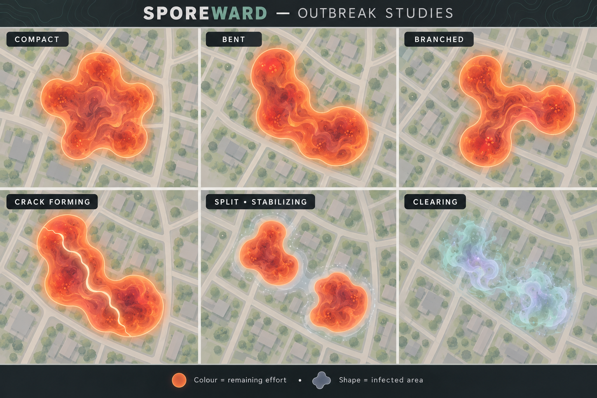

# Sporeward — Working game concept

Player-facing gameplay information is maintained in [Player rules](player-rules.md). This document contains the design rationale, development details, balancing parameters, and unresolved questions.

Development stages and MVP acceptance criteria are maintained in the [Development roadmap](development-roadmap.md).

Native development targets Android first, using the project owner's device for initial field testing. iOS follows when the Android experience is sufficiently mature and an external tester is available.

The selected stack and current scaffold are described in [Architecture](architecture.md). Initial browser/server/mobile entry points and shared packages exist; gameplay implementation and native recording are the next milestones.

## TL;DR;

- A location-based outdoor game where human-powered activity clears server-generated plague outbreaks. Players cooperate on cleanup while competing for personal points, with a recap after each activity.
- Familiar routes remain useful. Touching an outbreak counts; loops inside it give no extra reward. Each player can contribute to the same outbreak once every 6 hours, with no limit on distinct targets per activity.
- Outbreaks look fluid and organic. Visits start fast and slow withering phases; repeated crossings can form cracks and strategically split it into easier parts. Imported and privacy-hidden contributions can appear as incoming support squads.
- Show personal visit points, the locked cleanup bonus, and estimated remaining visits before departure. Repeat visit points diminish and slowly recover; growth never increases the cleanup bonus.
- The last eligible visitor receives the finishing bonus, including delayed cleanup. Nearby-in-time participants also receive it, and a fixed 10-minute post-cleanup protection window preserves full applicable points.
- Unresolved outbreaks visibly approach disintegration, then leave separate, non-growing remnants worth shares of the original bonus.
- GPS visit times determine scoring and cooldowns. Routes may be uploaded within 24 hours after activity completion; late awards do not revoke points already granted.
- Start with shared rules for all human-powered modes and publicly reachable targets. Location sharing defaults to everyone nearby, with off/friends options and private protection areas.
- Use zoom-level-17 map cells as the working simulation grid, with outbreaks spanning one or more cells. Outbreak sizes, balancing values, and several timing details remain provisional. Mobile/browser play and a route-planner overlay are intended; the initial application scaffold is in place.

This document describes the current Sporeward concept. These are provisional design decisions, not a final specification. Numerical values are configurable balancing parameters.

## Purpose and experience

A location-based outdoor game inspired by spreading plague outbreaks. Players cooperate to clear outbreaks while competing for personal points. The goal is to encourage more frequent rides, including ordinary commutes and familiar neighbourhood routes, rather than increasingly remote tile collection.

An end-of-ride recap explains contributions and points. Leaderboards cover monthly, yearly, and all-time performance. Launch scopes are global and country. Country attribution follows where the activity happened, not the player's home country: assign each scoring contact and its associated bonus to the country of that recorded contact. An activity crossing a national border can therefore contribute to multiple country leaderboards; each award also counts globally once. Add administrative-region leaderboards, such as Pirkanmaa and Uusimaa, when participation is sufficient; friends filters remain a later possibility. Award points to the month/year of the recorded qualifying visit in the timezone at that contact location, including bonuses awarded later. Global rankings aggregate these locally attributed awards.

During activity recording, the UI shows the current activity's running points tally. Distinguish confirmed points from provisional or pending awards where minimum-distance validation, delayed cleanup, or upload processing prevents immediate confirmation. Exact presentation remains open.

Outbreaks touched during the current activity have their own clearly identifiable map state, visually distinct from both eligible targets and other cooldown-ineligible targets. This visit marker records contact during this activity, even if that contact does not earn points; show scoring eligibility separately so the marker does not imply a successful award. Use an icon or other non-colour cue alongside colour differences. The treatment of cleared or split targets in this activity history remains open.

The intended product supports mobile devices and mobile browsers, accounts, location sharing, and server-generated outbreaks. Players can inspect outbreaks on the website or mobile app. Browser recording is a foreground-only option with an awake screen; native mobile recording is the intended path for background and screen-off activity, subject to real-device validation. A future browser extension should overlay outbreaks on an external route-planning tool so players can choose detours themselves. The cleaning simulation is a prototype; the repository has an initial application scaffold but no playable product yet.

## Map and appearance

Visual concept reference for outbreak shapes, cracks, splitting, and clearing:

Generate varied connected outbreak footprints rather than selecting from a small set of predictable patterns. The concept image captures the intended organic appearance and lifecycle states; its specific silhouettes are illustrative, not fixed templates. Ordinary spawns still occupy five connected cells, with smooth contour variation and subsequent growth producing diverse shapes. Preserve readable broad connections and public-route accessibility, including for split descendants.

The engine may represent infection with cells, but players see fluid, gently undulating regions rather than square tiles. Adjacent infected cells visually blend; an L-shaped arrangement can lightly shade the intervening corner to create an organic contour. Visual smoothing must eventually be reconciled with the actual contact boundary.

Outbreaks slowly expand into nearby cells, up to a limit. Size classes increase with growth. Show an estimated number of accepted visits still needed to clear an outbreak, alongside its size class, the player's available visit points, and the cleanup bonus. Estimates change with growth, ongoing decay, and other players' actions.

Growth adds cleaning effort proportionally to newly occupied cells: doubling occupied cells roughly doubles the baseline cleaning requirement, without increasing locked Y. Preserve earned cleaning rather than resetting progress on growth. Exact strength accounting remains to be specified.

Outbreaks remain separate and never merge, even when their fluid-looking edges touch. Each keeps its own points, cleaning requirement, visit history, and lifecycle. They may continue growing into available neighbouring cells under normal rules, but cannot overlap: a cell cannot belong to two outbreaks. Contact does not trigger merging or stop growth into other free cells. The UI must preserve distinguishable target boundaries where outbreaks meet; competing growth attempts for the same free cell require a deterministic resolution rule.

## Accepted visits

- Touching an outbreak is sufficient; traversing it from edge to edge is unnecessary.
- Starting or ending an activity inside an outbreak counts normally, provided the recorded activity reaches a minimum total distance of 500 metres, for all supported modes.
- Distance, loops, and time spent inside an outbreak do not add visit points or cleaning power.
- Each player can affect the same outbreak at most once every 6 hours. Ineligible repeat visits give neither points nor cleaning effects. Show these outbreaks in grey or another clearly distinct personal state.
- A ride can earn points from any number of distinct eligible outbreaks.
- GPS tracks supply crossing geometry and a combined heatmap for splitting mechanics, independently of visit scoring.

Use a 10-metre contact tolerance around the visible outbreak boundary. Imported GPS recordings require the 1-second recording setting, with timestamps on contact samples. Untimed GPS points cannot establish a visit. Allow up to a 2-second gap between consecutive timestamped fixes when inferring a crossing from their connecting segment, accommodating minor timing jitter or an isolated missed fix. For longer gaps, a visit requires an actual timestamped fix within the contact boundary, including its tolerance. Reject uncertain contacts rather than the entire activity; independently valid contacts elsewhere still count.

In-app contact detection may combine timestamped location fixes and their accuracy with short consecutive track segments to detect boundary crossings more reliably than testing individual points alone. Apply the same 2-second segment-inference limit. This cannot establish physical contact without adequate location evidence. Exact location accuracy limits remain to be specified.

## Cleaning, growth, and splitting

An accepted touch weakens the whole outbreak through two simultaneous phases: provisionally 25% of its cleaning effect spread evenly over 5 minutes and 75% spread evenly over 12 hours. Both begin together. Contact still provides immediate visual feedback and scoring feedback subject to activity validation. Visits add their effects alongside existing effects. Earned effects complete without a return visit; surviving outbreaks resume growth after the effects expire. The split ratio and durations are tunable.

A large group can deliver enough concurrent treatment to destroy an outbreak in less than 5 minutes. Always show a collapse animation lasting at least a provisional 5 seconds so destruction remains readable even when treatment greatly exceeds remaining strength. This visual duration does not delay mechanical destruction. The 10-minute post-cleanup protection window starts at mechanical destruction, not animation completion.

While cleaning effects are active, the outbreak withers and does not grow. Its occupied footprint may remain unchanged or shrink during this period, but cannot expand.

Shrinkage is non-uniform: boundaries retreat organically, heavily crossed areas weaken faster, and branches of a long outbreak may wither faster than its other parts. Preserve contact with a public route until cleanup or splitting; split descendants must each remain reachable. Uneven visual and spatial shrinkage does not grant extra cleaning power for distance or loops within a visit.

Ordinary withering does not automatically create independent outbreaks when a branch or connection becomes thin. Splitting is a separate gameplay event, not a consequence determined solely by footprint geometry. A branch can fade away without producing a child outbreak. Spontaneous splitting is disabled initially. A possible later spontaneous-split mechanism must not be shape-based. Retain two-child split events. How to represent temporarily disconnected infected patches under one outbreak identity remains to be specified.

Repeated tracks through similar locations encourage a visible internal crack and increase the probability of splitting during shrinkage. Visits distributed around different edges and directions should make splitting less likely. Following a crack is an intentional tactic, but the exact split moment remains uncertain.

The accepted starting probability model requires at least three accepted crossings concentrated along a similar corridor. The corridor must connect two edges and leave infected cells on both sides; edge touches clean normally but do not build a splitting corridor. Show the crack strengthening with qualifying crossings. Starting after the third qualifying crossing, each additional qualifying crossing has a provisional 20% chance to initiate splitting while the outbreak is shrinking. Use the strongest valid corridor. These values and corridor-matching tolerances are tunable.

Splitting creates two easier outbreaks, each independently touchable from a public route. Divide the remaining cleaning requirement, then provisionally reduce its total by 10%. Divide the locked bonus and pending cleaning effects without multiplying either total. Divide the parent's existing maximum-cell allowance. Children inherit its age and lifecycle timeline, with the remaining extension allowance divided between them. Exact division and integer-cell rounding rules remain open.

Splitting has a provisional 30-minute stabilization period. During it, the parts neither grow nor accept visits. Both children inherit player visit-point history and the parent's player-specific 6-hour cooldown expiry; splitting neither resets nor restarts that cooldown. A player can visit a child only after stabilization has ended and their inherited cooldown has expired. Players without an active inherited cooldown can contribute as soon as stabilization ends.

Pending cleaning pauses during stabilization and resumes afterwards, preserving its remaining effect rather than consuming it during the lock.

## Points and incentives

Use X for the player's currently available visit points and Y for the cleanup bonus. Y is locked when an outbreak is created: later growth never increases it. Ordinary outbreaks start with a uniform 100-point cleanup bonus.

| Event | Proposed points |
|---|---:|
| Ordinary accepted visit | X |
| Ordinary visit that clears an outbreak | X + Y |
| Accepted visit during disintegration | X |
| Disintegration-phase visit that clears the outbreak | X + Y |
| Clearing one disintegration remnant | Y / number of remnants created |

Disintegration-phase visits retain ordinary visit points and the cleanup bonus, encouraging intervention instead of waiting for remnants.

Repeat visit points diminish per player, provisionally by 50% each time. The suggested example is 100, 50, 25, 12, ... with a floor of 5; rounding and the floor are not final. Repeat cleaning strength decreases more gently than points: 100%, 75%, 60%, then 50% for subsequent accepted visits. The 50% floor keeps repeat contributions meaningful for a persistent solo player. This is the first balancing experiment; compare it with constant strength in the simulation. Cleaning-strength recovery after a long absence remains open.

Use uniform initial scoring for ordinary outbreaks rather than difficulty-scaled bonuses: first visit X is provisionally 100 points and cleanup bonus Y is 100 points, locked at spawning. Four equal disintegration remnants therefore award 25 points each. All ordinary outbreaks initially spawn at five connected cells, with a ten-cell growth cap. Varied spawn sizes are reserved for later. Accessibility-based cleaning requirements still vary independently of footprint within the initial 3–6-visit range.

Outbreak colour communicates remaining cleaning difficulty after subtracting all committed, not-yet-delivered cleaning effects, allowing equal-sized outbreaks to require different numbers of visits. The explicit remaining-visit estimate uses the same accounting. Colour can change as new treatment is committed or growth increases the remaining requirement. When committed effects suffice to destroy the outbreak without further visits, use a distinct "clearing" appearance rather than an ordinary difficulty colour. This does not reserve the finishing bonus; accepted visits can still change the finishing position. The exact palette and thresholds remain open. Preserve distinct eligibility and current-activity contact indicators so difficulty colour does not obscure those states.

Visit points slowly recover after a long absence. The starting proposal is recovery beginning after 72 hours without a visit and reaching full value over roughly two weeks. The recovery curve and timing require balancing to avoid rewarding deliberate preservation of outbreaks.

The cleanup bonus goes to the last accepted visitor before destruction, whether fast or slow decay finishes it. A later accepted visitor takes over the finishing position even if most cleaning came from earlier players. A proposed "clearing" state indicates that committed decay is sufficient; this does not reserve the bonus for the player who first triggered that state. Earlier participants share the bonus if their visits fall within the established group window; outside it, arriving at the right moment is an intentional competitive opportunity.

Other accepted visitors within 10 minutes before or after the final visitor's visit also receive the cleanup bonus. This is a per-player award, not a strict total payout budget for the outbreak. Ordinary cooldown-ineligible contacts do not qualify.

After cleanup, a 10-minute protection window preserves the target as a scoring opportunity. Eligible arrivals receive full applicable points, including visit points where that outbreak phase allows them and the cleanup bonus, rather than a reduced post-cleanup reward. The window must not roll forward with each new arrival. This is separate from the ±10-minute group window centred on the last contributing visit: both windows apply, even when delayed destruction makes them far apart. Each player receives the cleanup bonus at most once per target.

Players may upload recorded routes within 24 hours after activity completion. GPS visit time, rather than upload receipt time, determines scoring eligibility and the 6-hour cooldown. The activity-end reference for this deadline is a working interpretation; maximum activity duration is a separate unresolved limit.

Delayed uploads can reveal that an apparently available outbreak was already cleared. Award historically earned points to the late uploader without revoking points previously granted to others, accepting that additional bonuses can increase total payouts. Attribute delayed awards to the recorded visit's month/year. Historical event ordering and leaderboard settlement details remain open; present-time cleaning is described under activity sources.

## Disintegration and remnants

Unresolved outbreaks eventually enter a clearly announced "outbreak disintegrating" phase with a visible countdown, provisionally 24 hours before remnants form. Players can continue cleaning under normal effect and eligibility rules and can destroy the parent before it breaks apart. Eligible cleaning can extend the countdown within the finite lifetime extension allowance.

An untouched ordinary outbreak should provisionally take approximately 3–5 days from spawning to reach maximum size, then enter the announced disintegration phase. Ordinary outbreaks start at five connected cells and can grow to ten. This cap, growth pace, and the 24-hour countdown are tunable; the growth curve remains open.

Cleaning delays disintegration. A full-value accepted visit adds a provisional 2 hours, with repeat-visit extensions diminishing in proportion to the visit's point value relative to its full value. Each outbreak has a provisional 24-hour total lifetime extension allowance: all cleaning-related postponements combined can add at most one day, preventing routine commute contacts from sustaining it forever. Apply extensions to the expected disintegration time both before and during the announced countdown, using the same allowance; immediately update the displayed timing. These values are tunable. Split children divide the remaining allowance.

On disintegration, the parent creates up to four separate nearby remnants. Remnants do not grow or split and slowly disappear without intervention, provisionally within 72 hours. One accepted touch clears a remnant for its share of Y, without additional X points. Automatic disappearance gives no points and does not redistribute that remnant's bonus.

Remnants are fresh cleanup opportunities for prior contributors; diminishing parent visit points do not apply to their one-off bonuses. Place them on reachable nearby routes, with fewer remnants if suitable locations are unavailable. Avoid turning the mechanic into a requirement to carry a bicycle into remote terrain.

Scatter remnants along reachable routes provisionally 200–800 metres outside the parent's old footprint, measured from its nearest boundary, with clear gaps between them. One remnant may instead occupy the old footprint. Placement should offer a short cleanup circuit rather than allow every remnant to be collected from one spot. Minimum inter-remnant spacing remains to be specified.

## Local effort and balancing

Large outbreaks can require multiple players or repeated eligible visits from one persistent player. More accessible, busy neighbourhoods can reasonably require more effort than sparse areas.

New ordinary outbreaks initially require approximately 3–6 accepted visits to clear, assuming their full fast and slow cleaning effects and no intervening growth. Sparse areas tend toward three visits; accessible, busy locations tend toward six. This is a tunable starting range, not a requirement for multiple days of group activity. Growth and ongoing decay can change the live remaining-visit estimate.

An initial proposal is to estimate accessibility from the density of cycling-suitable streets and paths, rather than assuming accurate neighbourhood population data. Avoid changing an existing outbreak's difficulty unexpectedly mid-cleanup. Data sources, effort formula, spawn locations, and limits remain open.

## Travel modes and location privacy

Muscle-powered outdoor activity qualifies, including cycling, walking, and running. Electrically assisted cycling also qualifies: e-bikes and unassisted bicycles use the same cycling rules and scoring, because the rider is still exercising. Initially use common rules without mode-based point multipliers. Later leaderboards may offer all / walk / cycle views, with both assisted and unassisted cycling in the cycle category. Small mode-specific differences remain a future possibility; fairness between runners and faster cyclists is a design goal.

During activity recording, a player may appear on other nearby players' maps. Visibility fades with distance and disappears beyond a configurable kilometre threshold. Sharing is enabled by default for everyone nearby, with settings for off or friends only. Location precision remains open. The recording flow should clearly communicate the active sharing setting.

Players can define multiple protection areas on the map, such as home or workplace, where their position disappears from other players' maps. This is a visibility control, not yet a decision to exclude private activity data from server-side game processing. Protection must be enforced before location information is delivered to other players, not merely hidden by their map UI. Protection near area boundaries remains to be designed.

Protection areas initially use adjustable circles with a default 300-metre radius. Inside them, location is never shared, including in shared historical activity routes. Cleaning and scoring still work normally.

Nearby-player viewing radius defaults to 5 km and is configurable from 1–10 km. Fade players over the outermost 20% of the selected viewing radius. Refresh other players' positions every 10 seconds while the map is visible and interpolate movement between updates. Mark stale positions and hide them after 60 seconds without an update. These values are tunable. Enforce protection areas on every location sample before sharing, independently of map refresh intervals. Private or expired locations must not remain visible through interpolation.

## Recap, pending rewards, and replay

The recap shows total points, outbreaks visited, cleanup bonuses earned, and cleaning still underway. Bonuses earned after activity completion update the original recap and produce an in-game notification.

Show potential additional points from pending finishing bonuses separately from earned points, for example "240 earned · up to +200 pending", with potential bonuses itemised and the player's finishing or group-window status explained. These are conditional: another accepted visitor can take the finishing position, although contributors within the group grace window can still share the bonus. Pending bonuses must not inflate confirmed totals or leaderboard scores.

### One outing, multiple recording sources

A future outing-level view groups recordings of the same real-world outing into one player-facing entry. Show the contributing sources explicitly (for example, Sporeward and Garmin via Strava). Let the player switch between a combined track and each source's separate track. Retain source recordings, their timestamps, and their pause/gap boundaries underneath; grouping the display must not duplicate points or cleaning. Valid contacts from one source can cover another source's pause or missing coverage under the existing reconciliation rules. Outing matching, user correction, and the exact combined-track selection algorithm remain to be defined.

### Optional Strava score summary

Players may opt in to having their Strava activity text include a friendly, inviting Sporeward score summary that lightly promotes the game. Include the earned score and the plain game name, with **no URL or promotional link**. This is disabled unless the player opts in, preserves existing activity text, and uses server-confirmed earned points rather than potential bonuses. Exact wording, placement, and handling of later bonus updates remain open. Example direction: “Sporeward: 350 points earned pushing back the spores.” This is a future integration feature, not permission to edit existing Strava activities now.

### Replay

Provide personal activity replay showing the player's recorded route, outbreak contacts, and point events, with play/pause and playback-speed controls. Shared replays respect protection areas; the exact event presentation and treatment of later-awarded bonuses remain open.

A separate proposed feature is world-state replay for a selected map viewpoint/area over the past 24 hours. It would show historical outbreak evolution, including growth, cleaning, splitting, and destruction. Release priority, replay controls, event detail, and whether anonymous support squads appear remain open; historical player-location playback is not implied.

### Leaderboard periods

Leaderboard months and years follow calendar boundaries in the timezone of each outbreak contact, rather than uniformly using UTC or the player's device timezone. Cross-timezone activities attribute each award individually. Global periods finish progressively across timezones rather than at one worldwide instant. Recorded contact times determine period attribution; delayed award receipt does not. Final settlement must also account for the accepted import window and delayed cleanup awards.

## Placement and future trail targets

Initially every outbreak must be touchable from a public route. Its visual footprint can extend into forests or block interiors without requiring players to enter them.

Spawn placement primarily follows map accessibility and does not depend on recent player activity. Inactive areas can still receive outbreaks. An optional hybrid may slightly increase spawn likelihood near areas with substantial gameplay activity, but not directly at the activity locations. This remains a secondary influence; the nearby distance, activity aggregation period, and boost magnitude are not yet defined.

Start with moderate outbreak density: approximately 15–25 active ordinary outbreaks across a 5 × 5 km urban/suburban reference area, as discussed using central Tampere. This is a tunable baseline, adjusted for reachable land and public-route availability rather than treating lakes or inaccessible terrain as spawnable area. Whether remnants count toward a separate density cap remains open.

Placement should offer meaningful route choices and optional detours without making the most direct, easy A-to-B route reliably award points. Incidental encounters on familiar routes remain possible and useful; the intent is to avoid blanket coverage or concentrating all outbreaks on obvious main corridors. Exact spacing and placement rules remain to be designed.

When an ordinary outbreak is cleared, schedule a replacement elsewhere in the same area after a provisional 6–12-hour delay, subject to accessibility and target-density rules. Avoid immediately refilling the cleared location. How replacement scheduling handles natural disintegration, remnants, and ordinary splitting remains open.

Remnants do not count toward ordinary target density. Ordinary outbreaks created by splitting may count toward it. The resulting replacement scheduling details remain open.

Outbreaks grow around neighbours into free connected cells, without pushing or moving other outbreaks in the initial rules. Visually, growth forms rounded lobes and may wrap around a neighbour while preserving distinguishable boundaries. Prefer broad growth over narrow tendrils. A locally blocked boundary does not prevent growth elsewhere. If exceptionally no free connected cells remain, the normal growth deadline still leads to disintegration below maximum size, subject to earned extensions. Growing around neighbours remains the normal behaviour.

## Activity sources and validation

Support activities recorded in the app and activities received through a Strava integration. Do not support manual GPS-file uploads. Always validate the minimum activity distance before granting accepted-visit rewards or effects. Strava activities are intended to let players participate without running the game app on every outing.

Apply the normal 24-hour activity eligibility window to Strava imports, including activities recorded before account creation. Do not impose a signup-time cutoff. Use the existing activity-completion reference for the window; activities completed more than 24 hours before receipt do not count. Historical outbreak contact and other validation rules still apply.

In-app activities use manual Start and Stop, with explicit Pause and Resume controls for breaks such as coffee stops. Pausing keeps the same activity open but stops route recording and live location sharing to save battery. No new outbreak contacts count while paused. Resume starts a new track segment; never infer scoring contacts or add travelled distance across the pause gap. Previously earned cleaning continues normally. Do not automatically finish an activity because the player is stationary.

Persist recorded activity through app closure or phone restart. When the app reopens, automatically resume an interrupted, actively recording activity as a new track segment; never infer distance or contacts across missing time. Preserve an explicit Pause state and the recording safety limit rather than overriding them through recovery.

Without internet, keep recording locally and provide contact feedback using the last available map state. Show points as provisional until the server validates contacts after reconnection. The cached map may differ from the live world.

After an activity has been open for 24 hours, stop collecting new location data and require an explicit Resume or Finish action. This recording safeguard is separate from the 24-hour post-completion import deadline. Details of the limit after an explicit resume remain open.

An in-app pause only suspends that recording source. Independently valid Strava contacts still count, including when the player forgot the app on pause. Reconcile overlapping contacts under the same earliest-contact and cooldown rules.

Keep in-app and Strava recordings as separate source records underneath the shared outing view: either may contain only part of an outing. Combine their outbreak contacts without discarding contacts unique to either source. For the same player's duplicate contact with the same outbreak, use the earliest recorded contact timestamp once for scoring, cleaning, and cooldown accounting, regardless of receipt order. Later genuinely separate visits remain eligible under the 6-hour rule. Exact contact matching, duplicate GPS/heatmap handling, and reconciliation with already-granted points remain open.

Match imported visits against outbreak positions and eligibility at the recorded contact time, then start their treatment in the present without rewinding the live world. Historically eligible points remain awardable without revoking prior awards. For already cleared targets, award historically eligible points but apply no cleaning to unrelated replacements. For split targets, divide imported treatment among surviving descendants without multiplying its total effect; exact allocation remains open. Finishing order uses recorded visit time rather than import receipt or support-squad arrival time.

## Incoming support squads

Validated imported contributions appear to other players as incoming CDC-style support squads representing earlier riders. A brief approach phase, provisionally 1–2 minutes, announces incoming cleaning before both fast and slow treatment phases begin. These timings and the final fictional organisation name remain adjustable. Support squads represent earned player contributions, not independent NPC cleaning.

Ordinary visible live-player activity does not dispatch a support squad. Privacy-hidden live activity is the exception: observers may see anonymous support-squad treatment instead of a rider. Its cleaning starts at contact under the same rules as visible live activity; the squad is only a public visual representation and does not delay its effects. Do not expose identity, route, precise contact time, or a traceable squad origin through this representation. Privacy settings do not change cleaning strength or timing.

The working simulation grid uses zoom-level-17 map cells. Ordinary outbreaks initially spawn at five connected cells and can grow to ten. Varied spawn sizes are a later extension. Single-cell targets may be used for remnants. Cell size is not outbreak size. Fine cells support growth contours, crossing heatmaps, and visible splitting, while reachable placement determines whether a target is playable. These map cells vary in physical size with latitude and must not be treated as globally fixed 186-metre squares.

A future extension may place special bonus outbreaks on mountain-bike trails, using OpenStreetMap mtb:scale values 0–5 as a proposed difficulty input. This would offer walking and mountain-biking alternatives. The data interpretation and suitable access rules must be verified when designing that extension; it is not part of the initial rules.

## Remaining design questions

### First cleaning simulation

The [first interactive experiment](visualizations/sporeward-cleaning-lab.html) compares gentle repeat cleaning (100/75/60/50%) with constant cleaning strength. It separates visit points from cleaning units and allows simulated time advancement and contributions from multiple players. It also models cracks, two-child stabilization, cleanup/group bonuses, and disintegration into remnants. Its canonical source is an inline HTML fragment with an embedded bundle generated from the shared TypeScript engine in `packages/game`. Run `npm run build:lab` after rule changes; the workspace check rejects a stale bundle. Generated standalone previews remain local exploration files.

The experiment has three repeatable button-driven scenarios across West, Central, and East targets: a solo return route tests independent cooldowns and diminished points/cleaning; group cleanup tests shared bonuses and the post-cleanup protection window; a seeded crossing scenario tests splitting, conservation, stabilization, and inherited cooldowns. Each scenario starts from fresh state and reports assertions against the same simulation functions used by manual play. An embedded Tampere basemap shows illustrative target positions and visit-order connections; it is not road routing or GPS contact validation.

Provisional simulation assumptions: a full-strength visit delivers one cleaning unit; initial effort is selectable at 3, 4, or 6 units; growth adds proportional strength over a four-day baseline; the lifecycle clock advances even when treatment suppresses growth. A one-day announced disintegration phase follows, with accepted extensions capped at one additional day. This clock is an experiment rather than a finalized lifecycle specification.

The experiment uses continuous cell-equivalent area, illustrative contours, minute-resolution time steps, and equal split allocation. It does not validate real routes, model accessibility or imports, generate replacements, or implement the final collapse animation. Visit-point recovery uses a provisional linear curve; cleaning strength retains its repeat-visit floor because recovery of cleaning strength is still unresolved.

### Open decisions

- Late historical event ordering, duplicate contact reconciliation, and leaderboard settlement without revoking granted points.
- Visual/contact boundary agreement, location accuracy limits, and historical contact matching.
- Growth curve and proportional strength accounting for added cells.
- Per-visit lifetime extensions and whether expired treatment resumes growth during an already-announced disintegration countdown.
- Split corridor tolerances and allocation and integer rounding of inherited properties.
- Density accounting after splitting/disintegration and replacement scheduling when target density is already met.
- Visit-point rounding and diminishing/recovery curve.
- Administrative-region launch thresholds and leaderboard settlement timing.
- Replay event presentation and recap details.
- Location precision and protection-area boundary behaviour.
- Recording-limit behaviour after explicit resume, Strava eligibility, invalid activity handling, and route-planning integration targets.

Background on the different tile-collection model: [Tile hunting](tilehunting.md).
