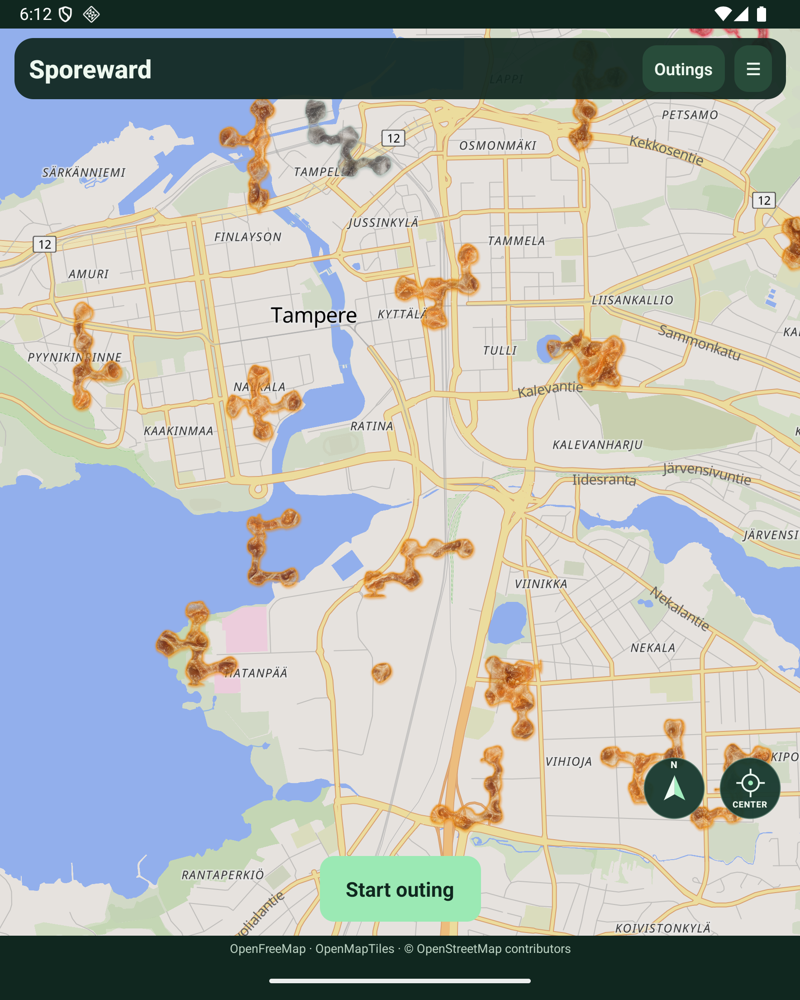
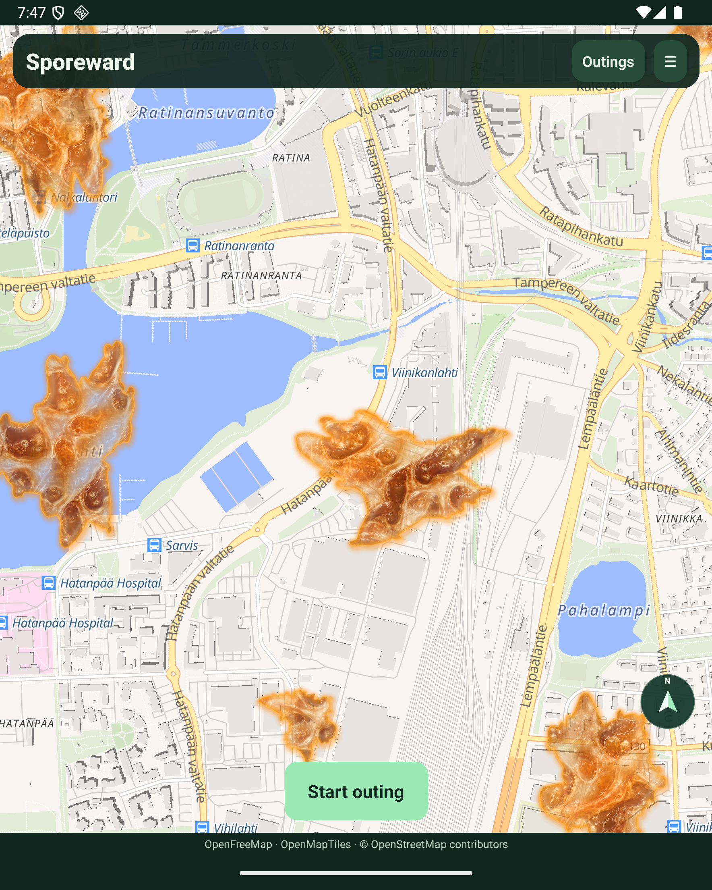

# Native outbreak rendering — superseded texture implementation

The owner rejected this heavy surface treatment on the phone. The replacement is documented in [Richer native rendering](native-richer-rendering.md); historical implementation evidence follows.

The Android map uses the accepted [wet-growth prototype](rendering-prototype.md) material. `packages/rendering` contains its platform-neutral pixel shading and continuous shape generator. The browser and native adapter use the same pigment, opacity, wet relief and luminous-pool calculations.

`growth-raster.ts` uses Skia to prepare the bundled original wet-fold texture, rasterize the server polygon, shade its interior, and draw the soft rim and tinted shadow. PNGs are stored in the app cache and attached to MapLibre image sources with geographic corner coordinates. Zooming and rotation therefore transform the entire material and its border together. The 24 m image padding contains decoration; it does not expand the contact polygon.

The server uses the shared continuous generator for authoritative outlines. Historical footprint intervals retain their earlier shapes for delayed activity matching. Regional water masks are not introduced by this adapter.

Only visible outbreaks receive detailed images, nearest first (at most 40 mounted images). The cache retains at most 64 images, keyed by identity, polygon and material state. One image is generated per scheduled task; generation pauses when the app is in the background. Old process files are cleared lazily on first use; evicted and unmounted images are deleted. Flat geographic polygons remain visible while images load or if rendering fails. This also preserves the polygon hit targets used by outbreak details.

The original texture is bundled for offline use. Rendering does not need a new server image endpoint or an active GPS recording. Grey folds indicate cooldown, pale mint/lavender indicates committed clearing, and amber/red retain the effort colour grouping. The turquoise activity outline remains separate from the material.

Skia requires a native rebuild after installation; Expo-compatible Reanimated and Worklets are included. The compass and centering glyphs use explicit drawing geometry instead of font arrows.

Focused checks:

```sh
npm run typecheck --workspace @sporeward/mobile
npm run typecheck --workspace @sporeward/web
npm run typecheck --workspace @sporeward/rendering
npx vitest run packages/rendering/src/material.test.ts apps/web/src/rendering/footprint.test.ts
```

## Runtime evidence — 20 October 2026

The graphics-enabled debug APK builds and runs on the API 36 Fold emulator against the isolated replay API. Runtime inspection confirmed textured polygons at neighbourhood and close zoom, grey cooldown and pale mint/lavender clearing material, panning/centering controls, north/track mode switching, and scoring details opened by tapping the textured polygon. The fullscreen header and attribution stay clear of the Android system bars. The idle start button uses a compact centered layout.



[Close view and aligned controls](images/native-wet-material-close-20261020.png), [clearing-state view](images/native-wet-material-clearing-20261020.png). These captures still show the old server silhouettes; they demonstrate material and UI integration, not completion of the continuous-shape migration.

### Continuous outlines and server cost



Canonical shapes are computed once per outbreak and persisted. Ordinary growth/withering scales the stored outline; it does not sample the full generator again. Neighbour subtraction prevents overlap without merging. Unrepresentable cuts retain a valid previous outline instead of filling over a neighbour.

Local measurements for 600 shapes: cold generation took 57 seconds, while 600 cached affine updates took 7 ms. The field's 620 bases were therefore prepared offline before deployment; the complete migration calculation took 299 ms locally, including clipping. The stored base artifact is about 2.3 MB. Actual clipped field rings had at most 271 vertices, below the protocol limit of 500. Future new outbreaks pay the cold cost once; restarts reuse stored bases.

The field migration was backed up before applying. Contour version 4 and all 620 precomputed bases are present; historical footprint intervals remain archived. Authenticated public health returns 200, unauthenticated health returns 401. A post-start snapshot showed API memory at approximately 525 MiB within its 3 GiB limit. These are observed samples, not a sustained-load benchmark.

Mobile, web, server and shared-rendering typechecks pass. Focused material, contact/history, continuous-outline and neighbour-separation checks pass. No field world reset was performed.

The standalone release APK builds and passes the packaged Android permissions check. It was installed in place on the owner's USB-connected Fold5 after confirming no app service was active. Its existing account and recordings were retained; physical-phone visual acceptance remains the owner's next check.
