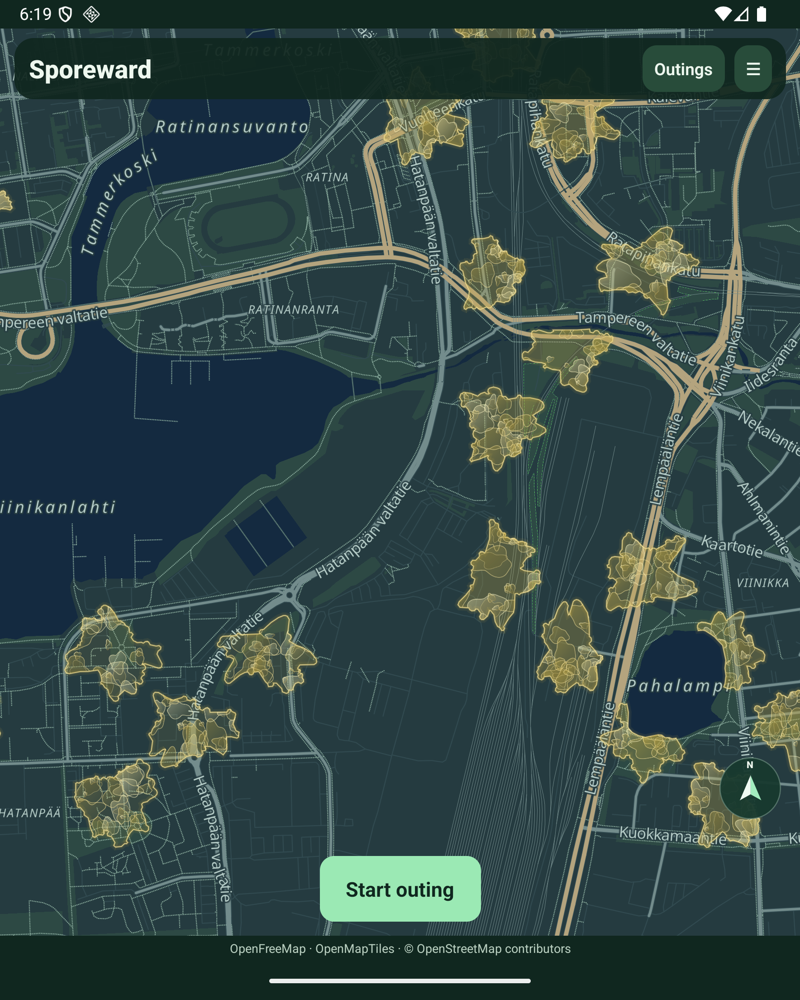

# Richer native rendering — implementation history

This page retains dated implementation observations and intermediate review notes. Later, on 22 October 2026, the owner accepted the Fold5 visual baseline including shoreline containment; see the [archived visual showcase tasks](../openspec/changes/archive/2026-10-22-replicate-approved-visuals-and-showcase/tasks.md) and [finished goals](finished-goals.md). The historical “pending” statements below describe their checkpoint, not the current visual-acceptance state. They do not imply broad performance or GPS reliability.

The accepted style uses translucent bodies, overlapping gradient membranes, refined rims and slow organic motion, including smaller faster layers. Night is the default; **Bright map** persists across map views and restarts.

## Current emulator implementation

`RicherMapImages.tsx` draws gradient-vector membranes with Skia into cached, geographically anchored images. Native MapLibre ImageSources and native body/rim/state layers handle pan, zoom and rotation placement. There is no screen-space overlay following asynchronous projection events. The rejected per-pixel wet texture shader is not used.

The nearest four detailed outbreaks have eight cached poses with native opacity transitions every 500 ms. Up to 24 bodies across the visible view and a half-viewport preparation margin have cached interiors, with visible bodies prioritized. Padded images are bounded to 512 pixels, the LRU cache to 192 entries, and material sources to 52. Generation yields between poses; bodies appear independently of image readiness. Background/reduced-motion states stop the animation timer; directory cleanup waits for native decoders to release their files. Reduced motion retains a single pose. These are implementation details, not a regional performance guarantee.

## Evidence and limits

Historical emulator measurements captured changing interior pixels and map-native artwork during a fast pan. The initial image cache occupied approximately 4.6 MiB; the emulator process later reported roughly 597 MiB PSS, including the development runtime and basemap. Neither value establishes physical-phone performance. The accepted visual review is recorded in the archived showcase; these measurements are not a broad performance benchmark.

The owner confirmed the earlier overlay lags on both emulator and Fold5. Removing projection round trips improved settled alignment but failed a fast-pan native-reference check; a direct UI-thread event experiment also showed separation. Those experiments were reverted before the map-native prototype. Do not use settled screenshots as proof of camera synchronization.

The map-native standalone APK was installed on the Fold5 on 2026-10-21 as an update, preserving app data. At that checkpoint phone approval had not yet occurred; the owner accepted the visual baseline the following day.

## Shorelines and field rollout

The isolated emulator world uses contour version 5: continuous shapes clipped against the regional OSM water mask, with identical display/contact boundaries and preserved historical intervals. Disconnected pieces across water are discarded, islands preserved, and candidates requiring unsupported polygon holes rejected or relocated. Public field-world migration is deployed and contour version 5 verified.

The mask uses the Finland OSM snapshot dated 2026-10-14 and is approximately 955 KiB compressed. Regeneration runs `scripts/world/extract-water.py`, then `scripts/world/tile-water.py`. An older 500-outbreak regional preview took 46.6 seconds for continuous surfaces and 1.53 seconds for shoreline preparation locally, preserving scores, contributions, bonuses and activities. The current 2,608-fixture field snapshot was privately backed up with owner approval; shoreline preflight took 2.26 seconds, changing 391 boundaries and relocating 10 outbreaks. After deployment, scores, contributions, bonuses and activity fingerprints matched the backup, the container was healthy and public authenticated HTTPS health returned 200. See [Field migration](field-migration.md).

At the 21 October checkpoint, owner phone feedback and final approval were outstanding. The later acceptance and its scope are recorded in the archived visual showcase tasks linked above.

## Shoreline cache failure and emulator comparison

The owner accepted Fold5 panning but reported water coverage in Viinikanlahti/Hatanpää. A read-only audit found 2,108 visible field outbreaks: the installed client rejected the response above its 1,000-outbreak limit, retaining the older map. The corrected parser allows 10,000 outbreaks with a one-million-vertex total budget. Native geometry is bounded to a padded viewport without reducing the world used for gameplay.

The emulator displayed an anonymized field-geometry fixture through the [read-only map viewer](replay-tool.md). At this dated checkpoint, owner review and the corrected phone installation were pending. The small yellow shapes were remnants from the field data, not a palette change. Three mask-idempotence discrepancies measured essentially zero water area and did not explain the reported bay-sized spill. The later owner acceptance is linked above.

## State shapes and progressive overview — 22 October 2026

The guide and Android share procedural clearing, remnant core/droplet and complementary splitting zipper contours. Native appearance curves are intersected with the existing authoritative footprints (the sibling footprint union during paused splitting), so rounded artwork cannot paint into excluded shoreline/water areas. Server contact rings, historical activity matching and rewards are unchanged. Geometry is cached by world snapshot; detailed geometry is not built at overview zoom.

At zoom 12+ the map uses geographic detailed shapes (static until zoom 14) and bounded membrane animation. Below 12, sparse points have simplified coloured bodies and small state badges. Below 12, native screen-distance clustering combines crowded points into area summaries; sparse points remain small badges. Summaries show only a centered number: the combined count of outbreaks and unexpired labs. Selecting a summary expands the cluster. Grouping begins separating at Overview −0.375 zoom, reducing native radii from 60 to 28 pixels, then 12 at +0.125; at +0.625 destinations appear individually, with grouping always ending by zoom 11.375. Distant labs use the circular antenna vector badge, with a collected check where applicable; detailed station art starts at zoom 14.5.

At this checkpoint, workspace types, 174 tests, lab consistency and strict OpenSpec validation passed. Native near/middle/far views, fixture counts and tap expansion were exercised. These implementation checks do not replace the later owner-accepted visual baseline or establish field reliability. The first area-summary design remains reviewable tuning.

Numbered group markers have a tapered radial glow 2.6 times their diameter. Zoom buttons move by 0.25 zoom levels. Detailed outbreak shapes begin at zoom 12; summary grouping ends at zoom 11.375, while small state badges remain until zoom 14.

Group fill and glow use the arithmetic mean of remaining outbreak visits through a muted ochre/terracotta/rose effort palette; labs are excluded and lab-only groups use muted mint. Split siblings share one centered badge while counts/effort retain both exposures. Remnant art is enlarged within its contact footprint. Labs use larger antenna/station art over circular native markers; the exact contact ring is shown from zoom 13.

Group discs use muted opaque effort colors with heavier soft cream numerals and no text halo; water-colored borders and tapered glow preserve area context without neon fills.

At this refinement checkpoint, mobile typecheck, the split-marker regression check, strict OpenSpec validation and whitespace checks passed. Native inspection confirmed one splitting badge, larger remnant art, circular lab presentation, later grouping, and muted effort-colored discs with cream counts. The later accepted visual baseline is recorded in the archived showcase; this note does not claim separate acceptance for every tuning detail.

Forming cracks now subtract a footprint-scaled angular trunk with tapered forks from the actual display geometry. The trunk crosses the outer boundary at both ends; boolean clipping prevents overrun and preserves concave exclusions. Native fill/rim, raster membranes and the web guide share this shape recipe. Geometry checks cover edge-to-edge continuity, fork openings, concave containment and existing holes.

The crack refinement passed five focused geometry/marker tests, mobile/rendering/web typechecks, strict OpenSpec validation and whitespace checks. A fresh emulator launch loaded the complete membrane artwork and showed the forming crack contained at both ends; local evidence: `zoom-shapes/cracks-edge-to-edge.png`.

Every detailed state now uses the broad Clearing halo, tinted by its state palette. Simplified body diameter scales are Heavy/Disintegrating 1.0, Medium/Cracking/Clearing/Splitting/Withering 0.9, and Light/Remnant/Cooldown/Visited 0.85. Lab center circles are doubled, new collection rings are circular with twice the former cell width in diameter, and all lab map labels are omitted.

Halo/lab/size refinement validation: ten focused tests passed, including circular collection inside/outside boundaries and effort diameter ratios; mobile, server, web and rendering typechecks and both active changes’ strict OpenSpec checks passed. Native inspection covered the label-free circular lab footprint, broad tinted outbreak halo and relative simplified body sizes. The read-only review fixture was regenerated with the new spawn geometry; previous persisted lab histories were retained.

Preparation begins at zoom 11.5 ahead of detailed display at zoom 12. Native camera-change events refresh preparation targets at most every 200 ms while panning, without using JS to position artwork. Base poses are generated before extra animation poses; offscreen neighbors are mounted for native image readiness but do not animate. Stable distance/id ordering and the existing 24-body / four-animation / 52-source / 192-cache caps remain. Instant jumps and dense views exceeding capacity can still require on-demand work.

Ahead-of-pan verification: three focused preparation/marker tests, mobile typecheck and strict OpenSpec validation passed. During a native pan, instrumentation showed one visible body and three offscreen neighbors ready, then two visible bodies ready as one entered; a mid-pan capture retained both interiors. Temporary readiness logging was removed. Development Fast Refresh retains cache files referenced by surviving pose-cache refs.

All detailed outbreaks share Clearing’s broad layered stroke halo: widths 38 and 16 in 77-unit body coordinates, with opacities 0.09 and 0.18. Only the state palette changes. The shared recipe is drawn with round joins into cached Skia artwork and in the web guide. Textures are padded by 28% of material radius and capped at 512 pixels. Cracked interiors remain excluded from glow. Ahead-of-pan preparation is retained.

New remnant collection contours have 2× nominal radius, clipped using existing shoreline and neighbor separation rules. Server matching and native artwork use the resulting ring. Focused tests check doubled extents, contact outside the former edge, exclusion beyond the new edge, neighbor separation and unchanged source geometry. The showcase is regenerated with this same expansion.

Restored layered-halo and enlarged-remnant verification: mobile/rendering/web/server typechecks, twelve focused tests and strict OpenSpec validation passed. Fresh emulator inspection showed broad stroke bands on Clearing and other state colors, and the enlarged remnant over its wider geographic footprint. Local evidence was retained under the ignored `zoom-shapes` review directory. The later accepted visual baseline is recorded in the archived showcase; no broad performance claim follows from these checks.
