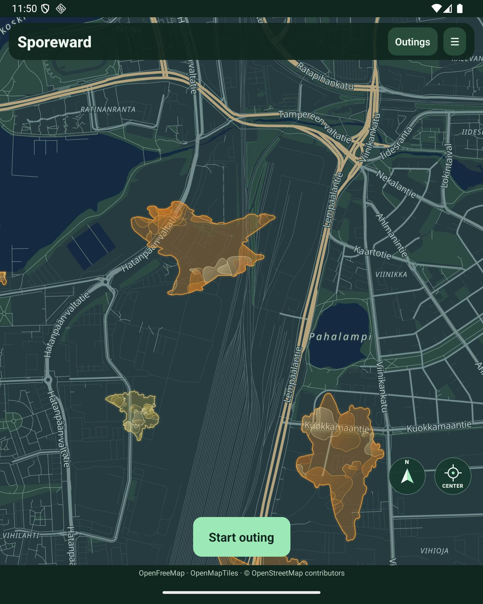

# Richer native rendering — owner review pending

The accepted style is a translucent base with overlapping gradient membranes, refined inner rims, slow independent breathing/skew, and smaller faster-moving layers. Night is the default; **Bright map** in setup switches all map views and saves the preference.

## Unified drawing

All visible outbreak bodies, soft rims and inner layers share one Skia canvas and viewport matrix. Native MapLibre polygons remain almost transparent hit targets. This avoids the separate-surface panning drift reported during the first emulator review.

Shared membrane definitions live in `packages/rendering/src/richer.ts`. Vector pictures are recorded once; UI-thread drawing transforms those pictures at approximately 30 updates per second, clipping interiors to authoritative rings. Recording bounds explicitly include negative coordinates. The viewport matrix is calibrated with native map projection. There is no image encoding, cache-file generation or per-frame texture shading.

Detailed interiors are limited to 24 visible outbreaks at zoom 12.5 and above; bodies remain visible farther out. Animation stops in the background and respects reduced motion. Routes and map labels still use native map layers; follow/rotation and route legibility remain review items.

## Shorelines

The isolated emulator world uses contour version 5: continuous shapes clipped against a regional OSM water mask. Display and GPS contacts use the same boundary. Disconnected pieces across water are discarded; islands are preserved. The current single-ring protocol cannot represent enclosed water holes, so such candidates are rejected or relocated rather than covering water.

`prepareShorelines` records changed footprints from migration time onward, retaining historical boundaries and gameplay contributions. The public field world has **not** been migrated; backup and migration-cost preflight remain required before deployment.

The mask comes from the Finland OSM snapshot dated 2026-10-14 and covers the Tampere riding region. Regeneration uses `scripts/world/extract-water.py`, followed by `scripts/world/tile-water.py`; dependencies are in `scripts/world/osm-requirements.txt`. The compressed mask is approximately 955 KiB. Twenty cold baseline spawns took about two seconds locally. An offline migration of the older 500-outbreak regional preview took 46.6 seconds to generate continuous surfaces, then 1.53 seconds for shoreline clipping (189 changed boundaries, 10 relocated outbreaks). Peak process RSS was approximately 410 MiB. Scores, contributions, bonuses and stored activities were unchanged. This is a local scale estimate; the current public field snapshot still requires its own preflight.

## Verified in the API 36 Fold emulator

- Long pans kept bodies and interiors together in inspected captures, but the owner subsequently reported that the combined overlay lags behind the basemap. Static captures do not prove camera synchronization.
- The former Viinikanlahti water-covered growth is now shoreline constrained.
- Both palettes display; Bright map persists after process restart.
- Twelve focused water/history/lifecycle/presentation tests passed, plus mobile/server typechecks and diff whitespace checks.

The owner authorized a standalone Fold5 comparison to distinguish emulator behaviour from device behaviour before further camera tuning. This is not emulator acceptance. Public field-world shoreline migration and final owner approval remain pending.

Standalone comparison APK built and installed successfully on the Fold5 on 2026-10-21. Installation used an in-place update after checking recording was inactive; no app data was cleared. Packaged location/task permissions passed inspection. Owner device feedback remains pending.

## Pending camera-lag investigation

Source inspection identified an avoidable delay: every camera event requests three asynchronous native `project` calls, and the overlay prefers the last completed projection matrix over the event's newer camera values. A serialized pending request can therefore keep the entire canvas behind the basemap. Native MapLibre emits camera-move events directly; no explicit throttling was found at that dispatch point. This identifies a likely contributor, not a measured sole cause. After the owner's Fold5 comparison, replace per-move projection round trips with event-driven transforms and calibration at stable boundaries, then verify pan/zoom/rotation alignment. The installed comparison build is unchanged.

Latest checkpoint: per-move projection requests were removed in an emulator-only iteration, but native reference outlines still revealed misalignment during and after panning. The temporary white reference layer was removed. This camera implementation remains unfinished; do not treat the checkpoint as accepted or ship it to testers. Fold5 feedback confirms the prior renderer also lags on real hardware.
