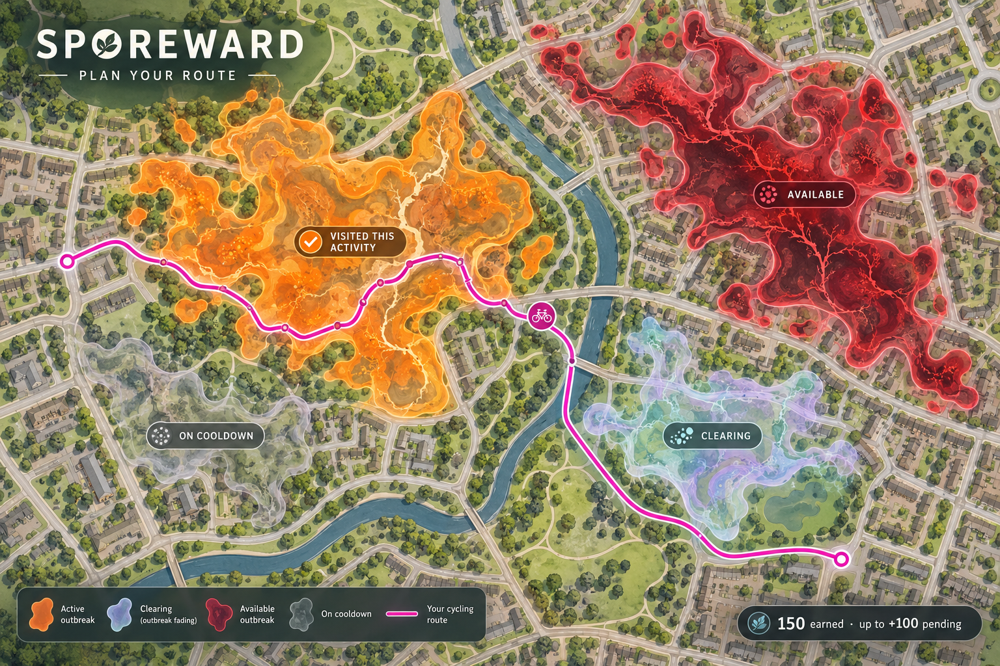
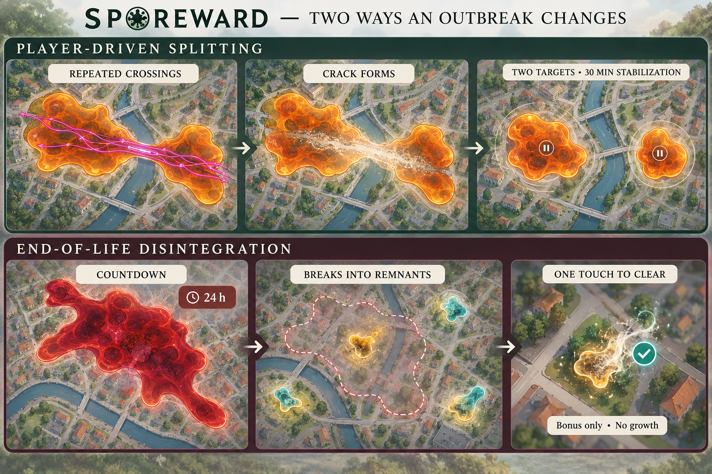

# Sporeward — Player rules

Sporeward turns outdoor exercise into a shared fight against spreading outbreaks. Walk, run, ride, or use another muscle-powered activity to help clear your neighbourhood and compete for points.

## Quick start

1. **Choose your route.** The map shows outbreaks, your available points, and how many more visits each target needs. Pick useful detours through reachable targets.
2. **Record your outing.** Use Start, Pause/Resume, and Stop in Sporeward, or connect Strava. Record at least **500 metres**; Strava activities must arrive within **24 hours** of completion.
3. **Touch outbreaks to earn points.** Entering an eligible region is enough. Visit as many different targets as you like; loops inside one do not give extra rewards. The same target counts once every **five hours**.
4. **Help clear them.** Visits start cleaning that continues after you leave. First visits earn **100 points**, repeat visits earn less, and finishing can give a **100-point bonus** shared with nearby-in-time participants.
5. **See what you achieved.** Follow earned and potential points during the outing, then review your recap and replay. Compete on monthly, yearly, and all-time leaderboards, globally and by country.

**Location sharing is on by default while recording.** Choose everyone nearby, friends only, or off, and add private protection areas for places such as home and work.

*Concept artwork; actual outbreak shapes vary.*

## Read the map

- **Difficulty colour and visit estimate:** show work still needed after accounting for cleaning already underway.
- **Clearing:** existing treatment should finish the outbreak, but the finishing bonus is still up for grabs.
- **Visited this activity:** marks your contacts separately from other eligible and cooldown-ineligible targets.
- **Cracks:** repeated crossings can split an outbreak into easier targets. Newly split targets stabilize before accepting visits.
- **Disintegrating:** a countdown signals that an unresolved outbreak will leave small remnants, each clearable with one eligible touch.

## Detailed rules

Read on for exact scoring, timing, recording, and privacy rules. These describe the current planned game; balancing values may change.

### Plan your outing

The map shows outbreaks as organic regions. Their colour and remaining-visit estimate indicate how much more cleaning they need, after accounting for treatment already underway. A distinct **clearing** appearance means existing treatment is expected to finish the job.

Check your available visit points, the cleanup bonus, and your eligibility before choosing a route. Outbreaks are reachable from public routes. You can visit as many different eligible outbreaks as you like during one activity.

### Record an activity

Use **Start**, **Pause**, **Resume**, and **Stop** in Sporeward, or connect Strava to count recorded activities. An activity must cover at least **500 metres** of recorded distance.

Pause stops Sporeward's recording and live location sharing. It keeps the activity open, while cleaning you already earned continues. Resuming starts a fresh route segment; movement during the pause does not count through that recording. Valid Strava contacts can still count during an in-app pause.

Interrupted active recordings are preserved and automatically resume when you reopen the app. Explicit pauses stay paused. After an activity has been open for 24 hours, recording stops until you explicitly resume or finish it.

Offline recordings are saved locally. Map feedback uses the last available outbreak information, and points remain provisional until validated after reconnection.

Strava activities must arrive within **24 hours of activity completion**, including activities recorded before you joined. Recommended: Set your GPS device to **one-second recording**. Location points need timestamps to establish visits. Longer gaps require a recorded point inside the spore area. Uncertain contacts are ignored while valid contacts elsewhere still count.

### Touch an outbreak to help

Entering or touching an outbreak counts, with a **10-metre boundary tolerance** for GPS error. You do not need to cross the whole region. Starting or ending inside it also counts once your activity meets the minimum distance.

One accepted visit gives a fixed cleaning contribution. Riding loops, spending longer inside, or covering more distance within the outbreak gives no extra visit points or cleaning power.

You can contribute to the same outbreak once every **five hours**. Earlier repeat contacts give neither points nor cleaning. The map distinguishes eligible targets, cooldown-ineligible targets, and outbreaks you touched during the current activity.

### Earn points

| Action | Starting points |
|---|---:|
| First accepted visit to an ordinary outbreak | 100 |
| Repeat accepted visits to the same outbreak | Approximately 50, 25, 12… down to 5 |
| Cleanup bonus | 100 |
| Clear one of four equal remnants | 25 |

Repeat visit points diminish for each player, but the visit's cleaning power stays the same. Visit points begin recovering after a 72-hour absence and return to full value over roughly two weeks.

The cleanup bonus is fixed when an outbreak appears. Letting it grow does not increase that bonus. Visits during the **disintegrating** phase still earn visit points and can earn the cleanup bonus.

Your current activity shows earned points separately from potential cleanup bonuses. Pending bonuses are conditional and do not count toward leaderboard totals yet.

### Cleaning and finishing

Each accepted visit starts two cleaning effects together: **25% over five minutes** and **75% over twelve hours**. Contributions from multiple visits add together. During treatment, an outbreak withers instead of growing; some branches and areas can shrink faster than others.

The **last eligible visitor before destruction** receives the cleanup bonus, even when earlier treatment does most of the work. Other eligible visitors within **ten minutes before or after that visit** also receive the bonus.

A separate **ten-minute protection period after destruction** lets eligible arrivals receive full visit points and the cleanup bonus. New arrivals do not extend this period. Each player can receive a target's cleanup bonus only once.

A clearing outbreak is still a finishing opportunity: another visitor can take the finishing position. Your earlier contribution may still qualify for a shared bonus through the group window.

### Cracks and splitting

Repeated accepted crossings along a similar corridor can develop a visible crack. Following that crack is a tactic for splitting an outbreak into two easier targets. Edge touches help clean but do not build a crossing corridor. Splitting is uncertain; a visible crack does not guarantee a split on your next visit.

Split targets stabilize for **30 minutes**, accepting no visits during that time. They inherit your previous visit-point history and the original five-hour cooldown expiry. Splitting does not restart or clear that cooldown.

Existing treatment pauses during stabilization and resumes afterwards. The two targets share the original bonus and remaining treatment; splitting also slightly reduces the total work needed to clear them.

### Growth, disintegration, and remnants

Untouched outbreaks grow over several days. They remain separate and do not overlap, growing around neighbours where space permits.

Near the end of their life, outbreaks show a **24-hour disintegration countdown**. Cleaning can postpone disintegration: a full-value visit adds two hours, with repeat visits adding less in proportion to their points. Total postponement is capped at **24 additional hours**.

If not cleared, an outbreak leaves up to four separate remnants. They do not grow or split and disappear by themselves within roughly **72 hours**. An accepted touch clears a remnant for its share of the parent's cleanup bonus, with no additional visit points. Natural disappearance gives no points.

Remnants appear on nearby reachable routes, generally 200–800 metres outside the old boundary; one may remain in the old footprint. Clearing ordinary outbreaks makes room for new targets elsewhere after a delay, so future outings offer different route choices.

### Imported activities and support squads

Recorded visits are checked against outbreak locations at the actual visit time. Valid imported contributions start cleaning when received, represented on the map by incoming support squads. Treatment does not rewind the current world.

An already-cleared target can still award historically eligible points, but its treatment does not affect an unrelated replacement. If the target split, treatment is shared among surviving descendants. Overlapping in-app and Strava recordings count unique contacts from both, while duplicate contacts earn points and cleaning only once, using their earliest recorded timestamp.

### Location sharing

While recording, your location is shared with nearby players by default. Choose **everyone nearby**, **friends only**, or **off**. Nearby-player viewing radius defaults to **5 km**, adjustable from **1–10 km**; players fade near its outer edge.

Add private protection areas for home, work, or other places. These are adjustable circles starting at **300 metres**. Your location is hidden inside them, including in shared activity routes, while cleaning and scoring still work normally.

Hidden contributions may appear anonymously as support-squad cleaning. Privacy settings do not change your cleaning strength or timing.

### Recaps, replay, and leaderboards

After an activity, see your points, visited outbreaks, cleanup bonuses, and ongoing cleaning. Later bonuses update that activity's recap and generate an in-game notification. Personal replay shows your route, contacts, and point events.

Planned later: recordings of the same outing from multiple sources appear together, with a combined track or separate source views. You may also opt in to a friendly Sporeward score summary on your Strava activity, without a promotional link.

Compete on **monthly, yearly, and all-time** leaderboards, globally and by country. Country points follow where each contact happened. Month and year follow local time at the contact location, even when points arrive later. Each award counts globally once.
