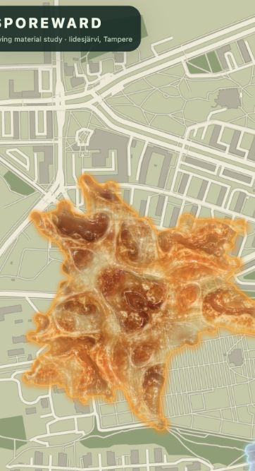
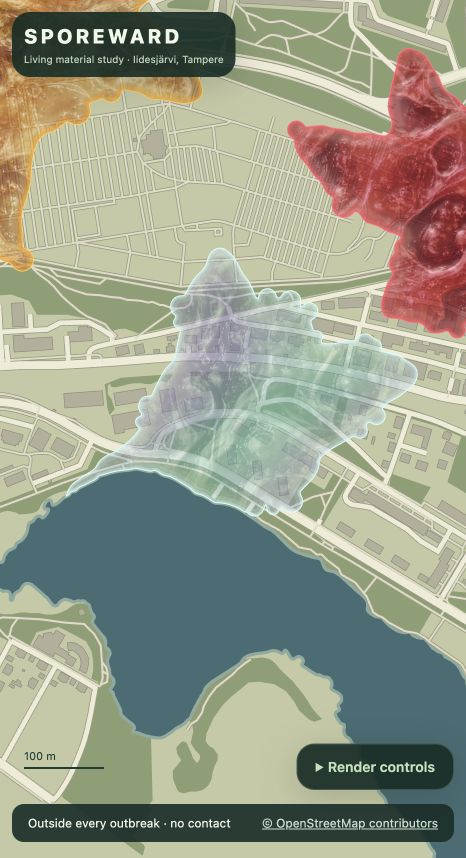

# Continuous outbreak rendering prototype

Visual baseline accepted by the user on 17 October 2026. Carry the current wet-fold material, rounded splashes, variable translucency, restrained luminous pools, soft rim and tinted shadow into integration. Further art refinement can follow later.

Run `npm run dev --workspace @sporeward/web -- --port 5174`, then open <http://127.0.0.1:5174/rendering>.

This isolated browser lab implements a rendering prototype based on the [fluid growth art target](images/sporeward-fluid-growth-target.png). It does not change the field world's historical boundaries, scoring or mobile app.

## What is implemented

- A seeded continuous surface creates each outbreak's body, broad curved protrusions and small rounded edge accumulations. Cells do not determine the silhouette.
- Marching squares samples that surface at 2 m spacing. Polygon subtraction then removes the **original mapped water geometry**, including island holes, and previously allocated neighbouring outbreak polygons. The shoreline is not approximated by the sampling grid.
- The resulting polygons are authoritative for both the Canvas clipping path and contact queries. The contact probe uses those same rings. Conservative level-17 cells are derived afterward through polygon intersection and used only for bookkeeping.
- A local tangent-plane projection converts geographic longitude/latitude fixes into metres around Iidesjärvi. It is suitable for this small prototype region, not a projection for the whole world.
- A synthetic 1 Hz outing follows a shortest path through connected OSM road/path vertices. Replay controls show first contacts using the same footprint. This is not a private user's track, a scoring simulation or a route-safety recommendation.
- Original generated material textures supply fine visual detail. **Wet folds** is the default: glossy pooled channels, soft raised folds and subtle relief highlights, inspired by the user’s slime references. **Membranes** offers finer mycelial detail for comparison on the same shape. Rotation and phase vary per seed; mirror repetition avoids hard tile seams. Shapes remain procedural. Exact prompts and provenance: [wet folds](images/spore-wet-folds-prompt.md), [membranes](images/spore-membrane-prompt.md).
- Opacity varies strongly between thin film and dense pools using smooth material density, independently of pigment brightness. Selected pools receive a subtle additive light layer that preserves texture contrast. A softened luminous rim and small colour-tinted offset shadow are drawn in geographic metres. Decorative halo/shadow pixels may extend outside the contact polygon; the live map clips these effects away from water. Contact geometry remains unchanged.

Use **Render controls** to focus a colour, change zoom/material, show bookkeeping cells or the exact contact boundary, generate new seeds or replay/scrub the outing. **Check rendering scale** renders all three states at two zooms using the actual live drawing function and measures visible alpha bounds in geographic metres. A 100 m ruler provides a visual scale reference. Drag to pan; scroll to zoom.

## Current rendered examples

Captured from the running browser lab on 17 October 2026. These are actual runtime screenshots. The shape and contacts come from the continuous polygons; the material texture adds appearance only.

## Evidence and limits

The focused `apps/web/src/rendering/footprint.test.ts` checks actual Iidesjärvi water exclusion, island contacts, neighbour exclusion, fully submerged growth, deterministic seed variation, projection round trips and first contacts from timestamped geographic fixes.

Runtime inspection covered default and second seeds at district, neighbourhood and close views, all three material states, and the same-shape wet/membrane switch. The 836-second replay completed in the browser: three contacts for the default seed and two for the second. Web typecheck, the five focused tests and the production web build pass.

The border-polish scale audit passed six renders: **0.94 m** maximum change in visible geographic bounds between zooms 0.4 and 0.8, and **14.16 m** maximum visible decorative halo/shadow reach. Audit tolerances are 2.5 m zoom variation and a 22 m effect envelope; at the distant audit zoom a physical pixel represents 1.25 m. The outward halo is intentional and scales with the map rather than staying fixed in screen pixels. [Runtime audit screenshot](images/rendering-border-polish-audit-20261017.jpg).

Follow-up visual feedback on 17 October added the softer glow and tinted shadow, widened translucency variation, and introduced restrained luminous pools. The light is additive so it preserves the original channel contrast instead of replacing dark pixels with flat bright pigment.

The visual pass compared rounded pooled silhouettes, layered translucent films, darker concentrations, fine detail, wet folds and bright rims with the target art. The current style is accepted as the integration baseline. This establishes the rendering approach; it does not make the illustrated map backdrop or the static art itself a runtime asset.

The OSM fixture is a bounded local extract. Blank map areas outside it are expected. The surface is static within a seed; lifecycle animation, growth around obstacles and splitting are not implemented in this lab. Shoreline subtraction may create disconnected components; production gameplay must decide how these are assigned to outbreak identities. The prototype does not change those gameplay rules.

Native integration should reuse the geographic polygons for server GPS matching and mobile clipping. A native GPU material or cached raster tiles can replace Canvas without changing contacts. Boundary migrations must preserve historical footprint intervals. Those production changes are separate from this visual prototype.

## Map source

OpenStreetMap map API extract for `23.785,61.488,23.810,61.500`, plus the full Iidesjärvi relation `18812986`. Attribution: © OpenStreetMap contributors, ODbL 1.0. The preparation script is `scripts/world/prepare-rendering-map.mts`; its two raw public API responses are local ignored inputs under `work/rendering/`.

Polygon operations use [polygon-clipping](https://github.com/mfogel/polygon-clipping).
